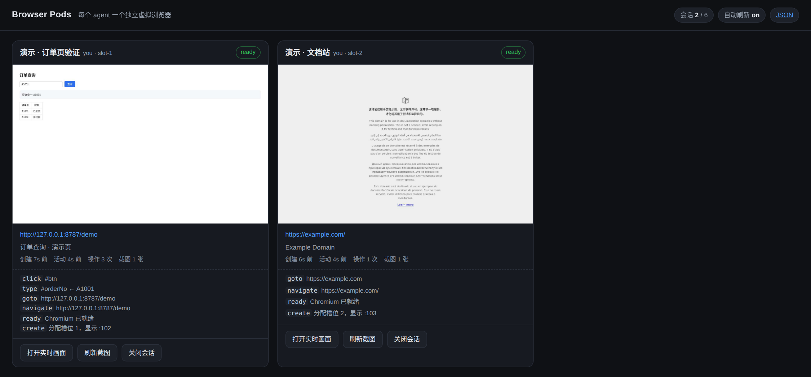
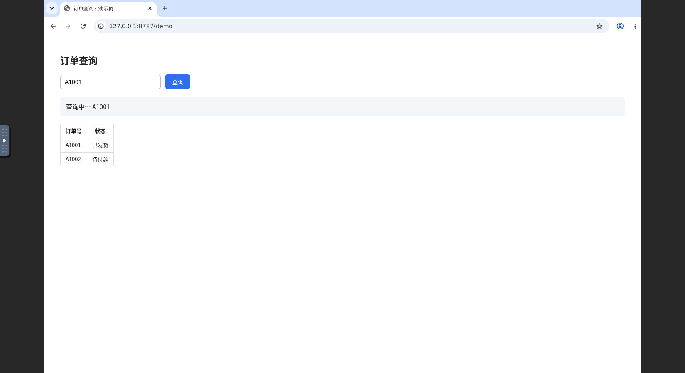
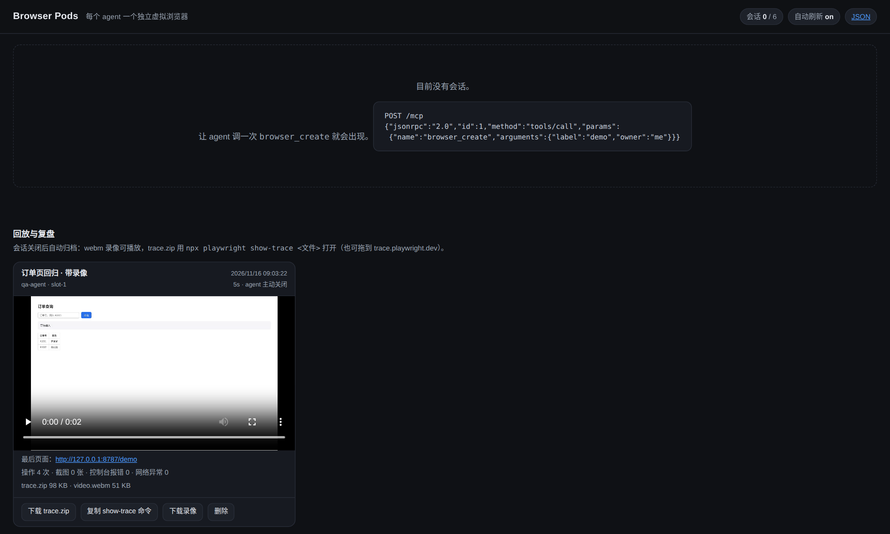

# browser-pods

给 agent 用的**浏览器沙箱**。一个 MCP 端点负责全部事情：开浏览器、操作页面、关掉并归档录像。
每个会话独占一个虚拟显示器 + 一个 Chromium，跑在容器里——窗口不会弹到你的屏幕上，也不会抢鼠标。

- **隔离**：每会话独立 `Xvfb` / profile / 进程 / 端口
- **可看**：每个会话一个 noVNC 实时画面（可接管），外加一个总看板
- **可复盘**：会话关闭后归档 `video.webm`（整场录像）+ `trace.zip`（Playwright trace）
- **可并发**：槽位制，多 agent 各开各的，默认 6 个；容器还能横向多开
- **零感知**：agent 只面对一个 `session_id`，端口和进程都藏在下面

---

## 一、架构

```
 agent A ─┐
 agent B ─┼── MCP over HTTP ──► ┌──────────────────────────────────────────────┐
 agent C ─┘   :8787/mcp         │ browser-pods 容器（host 网络，cgroup 限资源）│
                                │  pod-1  Xvfb :101 + Chromium + VNC :6081     │
                                │  pod-2  Xvfb :102 + Chromium + VNC :6082     │
                                │  pod-3  Xvfb :103 + Chromium + VNC :6083     │
                                │  控制面 :8787（看板 / REST / MCP）           │
                                └──────────────────────────────────────────────┘
 你 ── 浏览器 ──► http://127.0.0.1:8787/        看板（缩略图 + 操作日志 + 回放）
             └─► http://127.0.0.1:6081/vnc.html 某个会话的实时画面（可接管）
```

三层隔离：

| 隔离面 | 做法 | 效果 |
|---|---|---|
| 窗口 / 输入 | 每会话独立 `Xvfb` | 物理上不可能抢你的焦点和鼠标 |
| 登录态 / 文件 | 每会话独立 `user-data-dir` | 不碰你日常浏览器的 Cookie、书签 |
| CPU / 内存 / 进程 | 容器 `cpus` / `mem_limit` / `pids_limit` | 它炸了也拖不垮你的会话 |

---

## 二、快速开始

```bash
cd browser-pods
docker compose up -d --build     # 首次构建 5~10 分钟
curl -s http://127.0.0.1:8787/healthz
open http://127.0.0.1:8787/      # 看板
```

> 本机 docker daemon 的 DNS 解析有问题（`docker pull` 报 `no such host`），所以镜像完全用本机已有镜像构建：
> 基础层 `node:22-bookworm-slim`，apt 走阿里云源，npm 走 npmmirror，Chromium 由 Playwright 自己下载。
> **不需要从 registry 拉任何新镜像。**

冒烟（会真的并发开 3 个浏览器，跑完自动关）：

```bash
node scripts/smoke.mjs
node scripts/interact-test.mjs   # 点击 / 输入 / eval / 快照
```

---

## 三、怎么看页面、怎么看测试情况

### 1）看板（日常用这个）

`http://127.0.0.1:8787/`



每个会话一张卡：谁在用、当前 URL/标题、每 4 秒刷新的缩略图、最近 6 条操作日志、操作/截图次数，
以及「打开实时画面 / 刷新截图 / 关闭会话」。

### 2）noVNC 实时画面（要看真实交互时）

每个会话的 `live_view_url`，形如 `http://127.0.0.1:6081/vnc.html?autoconnect=1&resize=remote`。
这是该会话**独占的虚拟桌面**（默认 1440×900），不是你的真实桌面；能看到滚动、点击、输入，也能直接接管。



### 3）agent 自己的观察（写进测试报告用这些）

| 工具 | 返回 | 用途 |
|---|---|---|
| `browser_snapshot` | 无障碍树 YAML | 定位元素、断言结构（比截图省 token） |
| `browser_text` | 纯文本 | 核对文案、报错、列表内容 |
| `browser_screenshot` | PNG | 视觉回归、给人看效果 |
| `browser_console` | console + 未捕获异常 | 排查前端报错 |
| `browser_network` | 失败请求 + 4xx/5xx | 验证接口是否正常 |
| `browser_view` | 实时画面链接 | 让 agent 把链接回给你 |

### 4）事后复盘

会话关闭后，看板底部「回放与复盘」直接播录像、下载 trace：



---

## 四、接入 MCP

### DSH（已在 `web` profile 接好）

配置就是 profile 里的一条普通 MCP 条目，和 context7 一模一样，**可以在 toolbox 的 MCP 面板里编辑/停用**：

```yaml
# ~/.dsh/profiles/web/cordis.patch.yml
- insert:
    - id: mcp-browser
      name: '@deepseek-ai/dsh-mcp-client'
      config:
        serverName: browser
        transport: streamable-http
        url: http://127.0.0.1:8787/mcp
        failOnStartupError: false
        toolCallTimeoutMs: 120000
```

保存后会自动重载并重新同步工具列表；工具以 `mcp__browser__*` 出现，共 16 个。

> 曾经用 configuration-only bundle 装过：工具能出现，但 bundle 里的条目在 toolbox 里是**只读**的
> （`Mutation checks in callers still require the profile entry id`），所以改成了现在这种可编辑写法。

### 其他客户端

```bash
# Claude Code
claude mcp add --transport http browser-pods http://127.0.0.1:8787/mcp
# Cursor 等：Transport = HTTP，URL = 上面的地址
```

### 工具清单（16 个）

| 类别 | 工具 |
|---|---|
| 生命周期 | `browser_open`、`browser_close`、`browser_list` |
| 观测 | `browser_view`、`browser_artifacts` |
| 驱动 | `browser_navigate`、`browser_snapshot`、`browser_click`、`browser_type`、`browser_press`、`browser_eval`、`browser_wait`、`browser_text`、`browser_screenshot`、`browser_console`、`browser_network` |

典型流程：

```
browser_open({ label: "订单页回归", owner: "qa-agent" })      # → session_id / 实时画面 / CDP
browser_navigate({ session_id, url: "https://example.com/orders" })
browser_snapshot({ session_id })                              # 看结构
browser_click({ session_id, role: "button", name: "筛选" })
browser_type({ session_id, selector: "#kw", text_value: "A1001" })
browser_wait({ session_id, selector: ".order-row" })
browser_screenshot({ session_id, full_page: true })           # 留证
browser_network({ session_id })                               # 确认没有 4xx/5xx
browser_close({ session_id })                                 # 归档录像 + trace
```

---

## 五、生命周期

| 语义 | 行为 |
|---|---|
| 打开 | `browser_open` 起 Xvfb + Chromium + VNC + 录像，就绪后返回（实测 ~1.5s） |
| 关闭 | `browser_close` 停进程并归档 `video.webm` / `trace.zip` / `meta.json` |
| 空闲回收 | 默认 60 分钟（`POD_IDLE_TTL_MIN`），按最后一次操作算，**正在操作的不回收**；0 = 关闭 |
| 过期时间 | `browser_list` 里每个会话带 `expires_at` |
| 外部浏览器 | `browser_open({ cdp_url })` 只连接不新建；`browser_close` 只断开，不杀对方进程 |
| 打开失败 | 立刻清理半成品，不留孤儿 |
| 运维兜底 | `scripts/browserctl.mjs list / stop / gc`（agent 流程不需要它） |

---

## 六、并发与横向扩

| 维度 | 行为 |
|---|---|
| 会话上限 | `PODS_MAX`（默认 6） |
| 跨会话 | 完全并行：各自显示器、Chromium 进程、profile、端口 |
| 会话内 | 工具调用串行（互斥队列），多个 agent 抢同一 session 不会踩页面 |
| profile 复用 | `browser_open({ profile: "shop" })` 复用登录态；同一 profile 同时只允许一个会话 |
| 端口 | 第 n 个槽位：display `:10n`、VNC `590n`、noVNC `608n`、CDP `922{2+n}` |

一台机器不够就多开实例（各实例端口段自动错开）：

```bash
./scripts/scale.sh start 3     # 起 3 个实例
./scripts/scale.sh status
./scripts/scale.sh stop 3
```

| 实例 i | 控制面 | 显示器 | noVNC | CDP | 数据 |
|---|---|---|---|---|---|
| 1 | 8787 | `:121…` | 6101… | 9243… | `data/instance-1` |
| 2 | 8788 | `:141…` | 6121… | 9263… | `data/instance-2` |

> 多实例与 `docker compose` 单实例抢 8787，脚本会检测并提示先 `docker compose down`。

---

## 七、录像与复盘

会话关闭后归档到 `data/artifacts/<session-id>/`：

| 文件 | 内容 |
|---|---|
| `video.webm` | 整场录像，浏览器里直接播、可拖动 |
| `trace.zip` | Playwright trace：动作 + DOM 快照 + 网络 + 截图 |
| `meta.json` | URL、owner、时长、关闭原因、操作数、控制台报错、网络异常、事件时间线 |

```bash
npx playwright show-trace ./data/artifacts/<session-id>/trace.zip
# 或把 trace.zip 拖到 https://trace.playwright.dev
```

保留 `ARTIFACTS_KEEP=50` 份，超出删最旧；`RECORD_VIDEO=0` / `RECORD_TRACE=0` 可关。
trace 含页面 DOM 快照，可能有敏感信息。

---

## 八、配置项

| 环境变量 | 默认 | 说明 |
|---|---|---|
| `LISTEN_HOST` / `LISTEN_PORT` | `127.0.0.1` / `8787` | 控制面监听地址 |
| `PUBLIC_HOST` | `127.0.0.1` | 生成 noVNC 链接用的主机名 |
| `PODS_MAX` | `6` | 最大并发会话 |
| `POD_IDLE_TTL_MIN` | `60` | 空闲回收分钟数，0 = 不回收 |
| `MCP_DRIVER_TOOLS` | `1` | 1 = 含驱动工具（16 个）；0 = 只供应（5 个） |
| `VIEWPORT_W` / `VIEWPORT_H` | `1440` / `900` | 虚拟屏幕尺寸 |
| `DISPLAY_BASE` / `VNC_PORT_BASE` / `VIEW_PORT_BASE` / `CDP_PORT_BASE` | `101` / `5901` / `6081` / `9223` | 槽位端口基数 |
| `RECORD_VIDEO` / `RECORD_TRACE` | `1` / `1` | 是否录制 |
| `ARTIFACTS_KEEP` | `50` | 归档保留份数 |
| `MCP_TOKEN` | 空 | 设置后 MCP 与 `/api` 需要 Bearer |
| `VNC_ENABLED` / `VNC_LISTEN_HOST` | `1` / `127.0.0.1` | 实时画面开关与监听地址 |
| `INSTANCE_NAME` | `instance-1` | 实例名（看板与 healthz 显示） |

---

## 九、资源与安全

- 容器限额：`cpus: 6`、`mem_limit: 12g`、`pids_limit: 1024`、`shm_size: 1gb`；
- 空载 ~120MB；单个会话 ~300~600MB，6 个会话约 2~3GB；
- 默认只监听 `127.0.0.1`：控制面、noVNC、x11vnc 全部只在本机可达；
- 要给局域网看：`LISTEN_HOST=0.0.0.0`、`VNC_LISTEN_HOST=0.0.0.0`、`PUBLIC_HOST=<机器 IP>`，并**务必**设 `MCP_TOKEN`；
- 容器以宿主 uid 运行，`data/` 下的 profile 不会变成 root 所有。

---

## 十、排障

| 现象 | 原因 / 处理 |
|---|---|
| `Xvfb` 段错误（`libEGL_nvidia` / `swrast_dri`） | 宿主有 NVIDIA 库时 GLX 会崩，已默认 `-extension GLX`，Chrome 走 SwiftShader |
| `Xvfb` 报 `/tmp/.X11-unix will not be created` | 代码会先 `mkdir -p /tmp/.X11-unix` |
| Playwright 报 `chromium-1234` 不存在 | 版本错配。容器里由 `npx playwright install chromium` 固定；宿主机调试用 `BROWSER_CHANNEL=chrome` |
| `docker build` 报 DNS `no such host` | 本机 daemon 解析问题；构建时加 `--network=host`，或不依赖 registry |
| 工具都列出来但调用失败 | 容器没跑：`cd browser-pods && docker compose up -d` |
| toolbox 里改了配置不生效 | 保存会触发重载；仍不行就重启 `dsh web` |
| noVNC 打开黑屏 | 会话已关或 Chromium 挂了；看板状态会显示 `closed` / `error` |
| 看板缩略图不刷新 | 会话未就绪或页面在加载；点「刷新截图」 |

---

## 十一、目录结构与 Git

```
browser-pods/
├── Dockerfile              # 基于本机已有镜像构建，不依赖 registry
├── docker-compose.yml      # host 网络 + 资源限额
├── package.json
├── src/
│   ├── server.mjs          # 控制面：看板 / REST / MCP / 审计
│   ├── pods.mjs            # 会话生命周期：Xvfb + Chromium + x11vnc + noVNC + 录制
│   ├── mcp.mjs             # 16 个 MCP 工具
│   └── dashboard.html      # 看板
├── scripts/
│   ├── smoke.mjs           # 并发冒烟
│   ├── interact-test.mjs   # 交互回归
│   ├── browserctl.mjs      # 运维 CLI：list / show / stop / gc
│   └── scale.sh            # 多实例启停
├── docs/                   # 截图（看板、实时画面、回放）
└── data/                   # 运行时：profile、录像、归档（不入库）
```

仓库已用 git 管理，`data/`、`node_modules/`、日志都不入库：

```bash
git -C browser-pods status
git -C browser-pods log --oneline
```

---

## 十二、设计取舍与已知限制

**为什么没有把驱动拆成 chrome-devtools-mcp**：它的 `--browserUrl` 在进程启动时固定，而我们的 CDP 端口按槽位递增
（9223/9224…）。要覆盖并发就得配多个实例（`mcp__chrome1/2/3`），工具数翻倍、极易指错浏览器；
做成「当前会话代理」又会让驱动端缓存的 `pageId` 失效。所以驱动内聚在 browser MCP。
需要性能 trace / Lighthouse / 堆快照时，临时用 CLI 连当前会话的 `cdp_url`：

```bash
npx chrome-devtools-mcp@latest --browserUrl http://127.0.0.1:9223 --no-usage-statistics
```

其他限制：

- GPU 不可用：容器能看到 `/dev/nvidia0`、也能挂驱动库，但没有可用的 Vulkan ICD，
  Chrome 的 ANGLE 一律回落 SwiftShader（软件渲染）。对页面验证无影响，重 WebGL 会慢；
- 没有音频；单机部署，不是跨机调度（要多台就多跑实例，各自数据目录）；
- noVNC 无密码认证（默认仅本机可达）。
