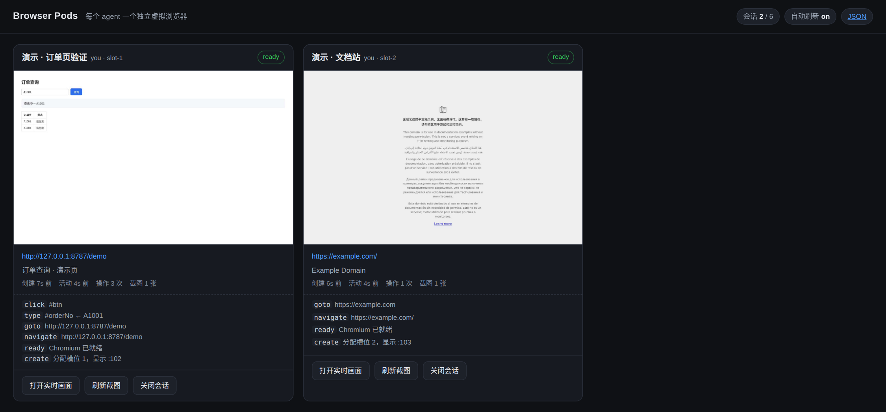

# dsh-browser-use

**面向 DeepSeek Harness（DSH）的 agent 浏览器控制：一个轻量的按会话插件 + 一个自托管的 MCP 浏览器沙箱。**

这个仓库包含两个相互独立、在**不同信任边界**上解决同一问题的组件：

| | **DSH 插件**（仓库根目录） | **browser-pods MCP 服务器**（`mcp/`） |
|---|---|---|
| 运行位置 | DSH 宿主内，紧挨用户 | 容器内（Xvfb + Chromium + noVNC） |
| 浏览器 | 用户本机真实的 Edge / Chrome，按会话隔离 profile | 沙箱虚拟桌面里的 Chromium |
| 优势 | 省 token 的观察、确定性安全层、审批、零依赖 | 隔离、实时画面、录像/trace 复盘、多会话并发、任意 MCP 客户端 |
| 传输 | DSH 工具 + 同源 Web 路由 | MCP streamable HTTP |
| 成本 | 不需要额外服务 | 需要 Docker 与 CPU/内存 |

**插件**适合浏览器可信、agent 需要便宜且精确操作的场景；**pod** 适合页面不可信、需要人盯着、
或者事后必须能复盘（录像 + trace）的场景。两者的定位与组合方式见
[docs/POSITIONING.md](docs/POSITIONING.md)（英文）。

> 插件目前还**不能**接管 pod 的 `cdp_url`：`browser_open({ cdp_url })` 是演进方向。
> 现阶段 pod 里的页面由 pod 自带的 MCP 驱动工具操作。

---

## 特点

### DSH 插件

- **零依赖的 CDP 驱动。** `index.js` 直接通过运行时全局 `WebSocket` 讲 Chrome DevTools
  Protocol，插件里没有 Playwright，也没有任何 CDP 库。
- **编号 ref，观察很小。** `browser_observe` 返回可见交互控件的
  `[r1] button "提交"` 形式列表（普通页面约 200–450 token），而不是 DOM dump。ref 是元素上的
  `data-dsh-ref` 句柄，`browser_act` 可以直接解析。
- **查询式读取。** `browser_read` 按问题返回命中的段落（Markdown），默认上限 8,000 字符，
  不用把整页塞进上下文。
- **一次一个动作，随后给 diff。** `browser_act` 每轮只做一次 click / type / press / scroll /
  hover / select，并报告 URL、标题以及增删改的控件，由模型决定是否重新观察。
- **确定性的安全层。** 导航只允许绝对 `http(s)` URL，并经过操作者策略文件（域名
  allow/deny 列表）；绝不向密码框输入；文件选择器与可执行文件下载交还用户；高风险动作必须
  显式确认。
- **审批带可视化证据。** 高风险动作会在可见浏览器里高亮目标、截图留证，并必须通过 DSH
  审批服务；会话策略为 `never` 时直接失败关闭（fail closed）。
- **按会话的能力开关，默认关闭。** 工具注册挂在读取
  `~/.dsh/capability-toggles.json` 的 `when` 谓词后面；Browser 标签页和输入框状态 chip 提供
  开关，保存后在下一步生效。
- **隔离 profile 与有界实例池。** 每个会话一个 Chromium 进程、一个独立 `user-data-dir`，绝不
  使用用户日常 profile；最多同时 3 个浏览器，空闲 15 分钟自动关闭。
- **用户接管与审计。** 高风险动作前把窗口带到前台，`show` 可随时唤出；每次 open/act/evidence
  都追加到 JSONL 审计（输入的文本从不落盘，只记录长度）。
- **DSH 原生 UI。** Browser 会话标签页（实例池、暂停/恢复、最近审计）、每个工具一张轻量卡片，
  以及只在浏览器打开或暂停时出现的紧凑状态 chip。
- **共存。** 插件驱动自己的 Chromium，不占用可选的 `browserUse` provider seam，因此可以与其他
  浏览器插件并存；状态路由会报告竞争插件，而不是猜一个 owner。

### browser-pods MCP 服务器

- **每会话容器级隔离。** 每个会话独占 Xvfb 显示器、Chromium 进程、profile 目录、端口和 VNC
  端点，窗口不会弹到用户桌面上。
- **实时画面。** 每个会话一个 noVNC 地址，可实时观看、可手动接管；另有一个带缩略图、操作日志
  和操作入口的总看板。
- **可复盘。** 关闭会话时归档 `video.webm`（整场录像）、`trace.zip`（Playwright trace：动作、
  DOM 快照、网络、截图）以及描述这次运行的 `meta.json`。
- **多会话并发。** 槽位分配，单实例默认 `PODS_MAX=6` 个会话；`scripts/scale.sh` 可以在同一台
  机器上横向起多个实例。
- **显式证书覆盖。** 默认校验证书；自签/内网 HTTPS 站点可以按会话用
  `browser_open({ ignore_cert_errors: true })` 显式信任，或用 `IGNORE_CERT_ERRORS=1` 让新会话
  默认忽略。
- **纯供应或一体化。** `MCP_DRIVER_TOOLS=1` 暴露 16 个工具（生命周期 + 页面驱动）；设为 `0`
  只暴露 5 个供应/观察工具，页面交给任意 CDP 客户端驱动。`docker compose` 里设为 `1`。
- **任意 MCP 客户端。** 一个无状态 streamable-HTTP 端点
  `http://127.0.0.1:8787/mcp`，DSH、Claude Code 或任何支持 MCP 的 agent 都能接。



---

## 环境要求

两部分的前置条件不同，而且**不需要都装**。

| 形态 | 宿主机需要 | 不需要 |
|---|---|---|
| **只装插件**（本机浏览器） | DSH（实测 `0.2.2-rc.5`，`web` profile）+ Microsoft Edge 或 Google Chrome | Docker、Playwright、`npm install`——插件没有运行时 npm 依赖，跑在 DSH 自带的 Node 上 |
| **只装 MCP**（浏览器 pods） | Linux 宿主机上的 Docker Engine 24+（含 Compose v2）；每并发 pod 约 1–2 GB 内存、镜像约 2 GB 磁盘 | Xvfb、Chromium、noVNC、Node/Playwright——全部在镜像里，宿主机不需要装浏览器 |
| **两者整合** | 以上两者；插件配置 pod 端点 | 形态 C（插件把会话路由到 pod）目前是设计提案，见 [docs/DEPLOYMENT-FORMS.md](docs/DEPLOYMENT-FORMS.md) |

- **Node.js：** 仓库声明 `engines.node >= 22`；插件本身运行在 DSH 宿主内。测试用 Playwright，
  按需安装：`npm install --no-save playwright@1.62.1`。
- **插件浏览器：** Edge 或 Chrome。自动探测覆盖 Windows 默认安装路径；Linux/macOS 或非标准安装
  请设置 `DSH_BROWSER_PATH=/path/to/chrome`。可见窗口需要桌面显示环境——无头服务器请用 pods。
- **MCP 端口（默认仅回环）：** `8787` 控制面/MCP、`5902+` VNC、`6082+` noVNC、`9223+` CDP。
  控制面要暴露到本机之外前，先设置 `MCP_TOKEN`。

快速安装：

```bash
# 只装插件
dsh plugin --profile web add github:nicken/dsh-browser-use

# 只装 MCP
cd mcp && docker compose up -d --build
curl -s http://127.0.0.1:8787/healthz
```

---

## 安装与快速开始

### 1. DSH 插件

把 bundle 装进 DSH profile：

```bash
dsh plugin --profile web add github:nicken/dsh-browser-use
```

如果 DSH 安装后没有自动启用，在 **Plugins** 里启用（安装对话框提供 **Enable now**）。插件是
按会话开启的，**默认关闭**：

1. 打开一个会话。
2. 打开 **Browser** 标签页，打开顶部的 **Browser control** 开关。
3. 保存的值在下一步生效；之后 agent 就能看到 6 个 `browser_*` 工具。

插件数据在 `~/.dsh/browser-use/` 下（profile、截图、策略、审计、暂停记录），能力开关在
`~/.dsh/capability-toggles.json`；需要时可以设置 `DSH_HOME` 覆盖 DSH 主目录。

最小 agent 流程：

```text
browser_open    { "url": "https://example.com/" }
browser_observe { "mode": "controls" }             # → [r1] link "文档", [r2] button "登录" ...
browser_act     { "action": "click", "ref": "r1" } # → changed: url=... added=... removed=...
browser_read    { "query": "价格" }                # → 命中的段落（Markdown）
browser_session { "action": "close" }
```

### 2. browser-pods MCP 服务器

```bash
cd mcp
docker compose up -d --build     # 首次构建约 5–10 分钟
curl -s http://127.0.0.1:8787/healthz
```

- 看板：<http://127.0.0.1:8787/>
- MCP 端点：`http://127.0.0.1:8787/mcp`
- 每会话实时画面：`live_view_url`，形如
  `http://127.0.0.1:6082/vnc.html?autoconnect=1&resize=remote`

在 DSH profile 的 `cordis.patch.yml` 里加一条 MCP 配置即可接入（工具随后以 `mcp__browser__*`
出现）：

```yaml
- insert:
    - id: mcp-browser
      name: '@deepseek-ai/dsh-mcp-client'
      config:
        serverName: browser
        transport: streamable-http
        url: http://127.0.0.1:8787/mcp
        failOnStartupError: false
        toolCallTimeoutMs: 120000
```

其他 MCP 客户端把同一个地址当作 streamable-HTTP 服务器：

```bash
# Claude Code
claude mcp add --transport http browser-pods http://127.0.0.1:8787/mcp
```

裸 JSON-RPC 往返示例（端点是**无状态**的，只接受 POST）：

```bash
curl -sS http://127.0.0.1:8787/mcp \
  -H 'content-type: application/json' \
  -H 'accept: application/json, text/event-stream' \
  -d '{"jsonrpc":"2.0","id":1,"method":"initialize","params":{"protocolVersion":"2025-06-18","capabilities":{},"clientInfo":{"name":"curl","version":"0"}}}'

curl -sS http://127.0.0.1:8787/mcp \
  -H 'content-type: application/json' \
  -H 'accept: application/json, text/event-stream' \
  -d '{"jsonrpc":"2.0","id":2,"method":"tools/call","params":{"name":"browser_open","arguments":{"label":"curl-demo","owner":"me"}}}'
```

`browser_open` 会返回 `session_id`、`cdp_url`、`live_view_url` 和 `expires_at`；把 `session_id`
传给驱动工具，最后用 `browser_close` 归档录像与 trace。

服务器起来后还有两个端到端脚本：

```bash
cd mcp
node scripts/smoke.mjs           # 并发开 3 个浏览器、操作、关闭并归档
node scripts/interact-test.mjs   # 点击 / 输入 / eval / 快照 全链路
```

---

## 工具清单

### 插件工具（6 个）

| 工具 | 用途 | 主要参数 |
|---|---|---|
| `browser_open` | 在本会话的真实浏览器里打开页面 | `url`（绝对 http/https） |
| `browser_observe` | 编号控件、纯文本或无障碍树 | `mode`（`controls`、`text`、`ax`）、`offset`、`limit` |
| `browser_act` | 针对 ref 或 locator 做一个动作，然后返回 diff | `action`（`click`、`type`、`press`、`scroll`、`hover`、`select`）、`ref` 或 `locator`、`text`、`keys`、`deltaY`、`option`、`intent`、`confirm_risk` |
| `browser_read` | 按查询读取页面文本，返回命中段落 | `query`、`maxChars`（400–20000，默认 8000） |
| `browser_session` | 查看/管理实例池、标签页与暂停 | `action`（`status`、`tabs`、`switch`、`show`、`pause`、`close`、`reset`）、`tabId` |
| `browser_evidence` | 截图、控制台输出或网络异常 | `kind`（`screenshot`、`console`、`network`）、`limit` |

需要知道的语义：

- `browser_act` 需要 120 秒内的新鲜观察；命中多个目标时拒绝而不是猜测。`press` 和 `scroll`
  不需要目标。
- `browser_session action=pause` 是模型侧的紧急停止；只有用户能从状态 chip 或 Browser 标签页
  恢复。`pause` 会阻断打开、观察、动作和读取。
- `reset` 被接受，行为与 `close` 相同：下次 `browser_open` 会开一个全新的浏览器。

### browser-pods MCP 工具（驱动工具开启时 16 个）

生命周期与观察（`MCP_DRIVER_TOOLS=0` 时只保留这 5 个）：

| 工具 | 用途 | 主要参数 |
|---|---|---|
| `browser_open` | 新建沙箱浏览器，或连接已有 CDP 端点 | `label`、`owner`、`profile`、`ttl_minutes`、`cdp_url`、`ignore_cert_errors` |
| `browser_list` | 列出会话：URL、空闲时间、实时画面、CDP 地址 | — |
| `browser_close` | 关闭并归档；外部浏览器只断开连接 | `session_id`、`reason` |
| `browser_view` | 返回 noVNC 实时画面与看板地址 | `session_id` |
| `browser_artifacts` | 列出已归档的录像/trace | `session_id`、`limit` |

页面驱动（`MCP_DRIVER_TOOLS=1`，`docker compose` 的默认值）：

| 工具 | 用途 | 主要参数 |
|---|---|---|
| `browser_navigate` | 跳转 URL 并等待加载 | `session_id`、`url`、`wait_until`、`timeout_ms` |
| `browser_snapshot` | 无障碍树 YAML，比截图更省 token、更适合定位 | `session_id`、`selector` |
| `browser_click` | 按 selector、role+name 或文本点击 | `session_id`、`selector`、`role`、`name`、`text`、`index`、`button` |
| `browser_type` | 先清空再输入，可回车提交 | `session_id`、`selector`、`role`、`name`、`text_value`、`index`、`submit` |
| `browser_press` | 发送按键或组合键 | `session_id`、`key` |
| `browser_eval` | 在页面上下文执行 JS 表达式 | `session_id`、`expression` |
| `browser_wait` | 等待毫秒数，或等待元素状态 | `session_id`、`ms`、`selector`、`state` |
| `browser_text` | 页面或元素的纯文本 | `session_id`、`selector`、`max_chars` |
| `browser_screenshot` | PNG 截图（内联图片结果） | `session_id`、`full_page`、`selector` |
| `browser_console` | 控制台输出与未捕获页面错误 | `session_id`、`limit` |
| `browser_network` | 失败请求与 HTTP 4xx/5xx | `session_id`、`limit` |

完整环境变量表、生命周期语义与排障见 [mcp/README.md](mcp/README.md)（中文），英文一页摘要见
[mcp/README.en.md](mcp/README.en.md)。

---

## 典型工作流

**本机 + 可信站点 + 省 token** —— 只用插件：

1. `browser_open` 打开页面。
2. `browser_observe` 拿 ref；`browser_act` 逐步操作。
3. `browser_read` 读内容；`browser_evidence` 取截图或控制台/网络证据。
4. `browser_session action=close`。

**不可信内容或需要可审计** —— 用 browser-pods：

1. `browser_open` 起一个 pod（`label` 给这次运行起名，看板上可辨认）。
2. 用 MCP 驱动工具操作，或者自己打开 `live_view_url` 看实时画面。
3. `browser_close` 归档 `video.webm` + `trace.zip` + `meta.json`。
4. 在看板的“回放与复盘”里看，或运行 `npx playwright show-trace <trace.zip>`。

**需要人介入时：** 本地浏览器保持可见（`browser_session action=show` 把它带到前台），或者看
pod 的 noVNC 画面；本地高风险动作会先高亮目标、截图，再等待审批。

---

## 配置

### 插件

`~/.dsh/` 下的路径：

| 路径 | 含义 |
|---|---|
| `browser-use/profiles/<sessionId>/` | 每会话的浏览器 `user-data-dir`（绝不是日常 profile） |
| `browser-use/policy.json` | 可选的操作者策略：`allowedDomains`、`blockedDomains`、`riskyIntentReplace`（字符串数组，按不区分大小写的正则解释） |
| `browser-use/pause.json` | 用户或模型写下的暂停记录；存在时阻断浏览器工具 |
| `browser-use/audit.jsonl` | 追加式审计；输入的文本从不落盘 |
| `browser-use/shots/` | 证据与审批用的截图（保留最近 40 张） |
| `capability-toggles.json` | 与其他能力插件共用的按会话开关 |

插件读取的环境变量：

| 变量 | 默认 | 含义 |
|---|---|---|
| `DSH_HOME` | `~/.dsh` | 所有插件状态的根目录 |
| `DSH_BROWSER_PATH` | — | 显式指定浏览器可执行文件（非 Windows 标准安装位置时需要） |
| `DSH_BROWSER_NO_SANDBOX` | 未设置 | 设为 `1` 时追加 `--no-sandbox --disable-setuid-sandbox --disable-dev-shm-usage`；只用于 Chromium 沙箱无法启动的容器/CI。见 [docs/SECURITY.md](docs/SECURITY.md) |

### browser-pods

关键变量（完整表见 [mcp/README.md](mcp/README.md)）：`LISTEN_HOST`/`LISTEN_PORT`（默认
`127.0.0.1:8787`）、`PUBLIC_HOST`、`PODS_MAX`（6）、`POD_IDLE_TTL_MIN`（60）、
`MCP_DRIVER_TOOLS`（compose 设 1，代码默认 0）、`IGNORE_CERT_ERRORS`（0）、
`RECORD_VIDEO`/`RECORD_TRACE`（1）、`ARTIFACTS_KEEP`（compose 20，代码默认 50）、
`MCP_TOKEN`（空）。

---

## 安全模型

两个组件的信任边界不同，任何一个都不能替代另一个：

- **插件以用户自己的操作系统权限运行**，与 DSH 在同一进程树里，**不是沙箱**。它提供的是模型
  与浏览器之间的确定性代码层：仅 `http(s)` 导航、操作者域名策略、高风险动作审批、拒绝密码
  输入、文件选择器与可执行下载交还用户、拒绝驱动 DSH 自身的 UI，以及只有用户能恢复的暂停。
- **pod 是容器边界**，不是虚拟机。默认只监听回环地址，每会话独立 Xvfb/profile，并归档录像。
  把 MCP 端点当作高权限接口：驱动工具可以在页面里执行 JavaScript，也能访问 pod 浏览器能到达
  的任何地址。

在把任何一部分暴露到 `127.0.0.1` 之外以前，请先读 [docs/SECURITY.md](docs/SECURITY.md)。
特别注意：`MCP_TOKEN` 设置后保护 `/mcp` 与看板/REST API（请求带 `Authorization: Bearer <token>`）；
`/healthz` 保持公开供容器探活。noVNC 没有密码认证，不要把它的端口暴露出去。

---

## 已知限制

- 插件不是隔离边界：恶意页面仍可能对模型做提示注入；点击跳转也不像 `browser_open` 那样经过
  URL 准入。浏览不可信内容时请收紧审批策略与域名策略。
- 插件实例池是全局的（跨会话最多 3 个浏览器），回收按时间（空闲 15 分钟）。
- 插件的浏览器自动探测针对 Windows 安装位置；其他平台请设 `DSH_BROWSER_PATH`。按设计没有
  `browser_eval` 式的任意 JS 执行工具。
- 插件目前不能接管 pod 的 `cdp_url`（见 [docs/POSITIONING.md](docs/POSITIONING.md)）。
- browser-pods 是单机部署（没有跨机调度），没有音频和 GPU 加速，noVNC 默认无认证。
- trace 含 DOM 快照，可能有敏感页面数据；录像以明文存在宿主机磁盘上。

---

## 目录结构

```text
.
├── index.js                 # DSH Host 半：CDP 客户端、工具、安全层、HTTP 路由
├── client.js                # DSH Web 客户端半：Browser 标签页、状态 chip、工具卡片
├── cordis.patch.yml         # DSH bundle patch（插入 browser-use 行）
├── locale/                  # 插件 UI 词典资源
├── icon.svg
├── tests/                   # 插件测试：假宿主脚手架、单测、真实 Chromium 集成
├── docs/                    # 架构、安全、开发、测试、定位
├── mcp/                     # browser-pods MCP 服务器（git subtree，保留完整历史）
│   ├── src/                 # 服务器、pod 生命周期、MCP 工具、看板
│   ├── scripts/             # 冒烟、交互、生命周期 CLI、多实例扩缩
│   ├── tests/               # 配置 + TLS 证书集成测试
│   ├── Dockerfile
│   └── docker-compose.yml
├── CREDITS.md
├── CONTRIBUTING.md
└── LICENSE
```

---

## 测试与 CI

```bash
npm install                 # devDependency：playwright
npm test                    # 插件单测 + 真实 Chromium 集成测试
npm run test:unit           # 不需要浏览器
npm run test:integration    # 需要 DISPLAY/xvfb-run 与 Playwright Chromium

cd mcp && npm test          # MCP 配置 + 自签 HTTPS 证书测试（需要 Xvfb）
```

GitHub Actions 工作流 `.github/workflows/ci.yml` 会在 Node 22 和 24 上跑插件测试、在 Node 22
上跑 MCP 测试，并在 `main` 上构建 Docker 镜像。前置条件与每个测试覆盖的内容见
[docs/TESTING.md](docs/TESTING.md)。

---

## 文档

| 文档 | 内容 |
|---|---|
| [docs/POSITIONING.md](docs/POSITIONING.md) | 插件与 MCP 服务器如何分工、每个任务该由哪个组件承担 |
| [docs/DEPLOYMENT-FORMS.md](docs/DEPLOYMENT-FORMS.md) | 三种形态（只插件 / 只 MCP / 整合为一个模型可见对象）的提案与迁移路径 |
| [docs/TOOL-SURFACE.md](docs/TOOL-SURFACE.md) | 把 6 个工具合并为 1 个默认 facade + 可选「高级」开关的提案 |
| [docs/ARCHITECTURE.md](docs/ARCHITECTURE.md) | 插件内部（CDP、观察、ref、安全、路由）与 MCP 内部（pod、录制、HTTP） |
| [docs/SECURITY.md](docs/SECURITY.md) | 两个组件的威胁模型、默认边界与部署建议 |
| [docs/DEVELOPMENT.md](docs/DEVELOPMENT.md) | 本地开发、目录地图、MCP 子树工作流、发布流程 |
| [docs/TESTING.md](docs/TESTING.md) | 测试套件、CI 矩阵、证书测试 |
| [mcp/README.md](mcp/README.md) / [mcp/README.en.md](mcp/README.en.md) | browser-pods 完整文档 / 英文摘要 |
| [CREDITS.md](CREDITS.md) | 灵感来源与真实使用的第三方项目 |
| [CONTRIBUTING.md](CONTRIBUTING.md) | issue/PR 流程、测试要求、提交约定 |

---

## 许可证

MIT —— 见 [LICENSE](LICENSE)。第三方组件保留各自的许可证；见 [CREDITS.md](CREDITS.md)。
