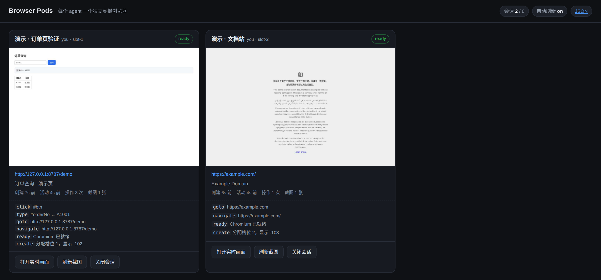

# browser-pods — English summary

**A self-hosted MCP browser sandbox.** `browser-pods` is the `mcp/` component of the
[`dsh-browser-use`](../README.md) repository: a containerised multi-session browser server with
live viewing and replayable recordings. It is also usable on its own — point any MCP client at it.

The full documentation is in **[README.md](README.md)** (Chinese). This page is a one-page English
overview; the deep architecture and security notes live in the repository's
[docs/](../docs/) directory.

## What it gives an agent

- One isolated **Xvfb + Chromium + noVNC** sandbox per session (own display, profile, processes and
  ports) — no browser window pops up on the user's desktop.
- A **single MCP endpoint** (`http://127.0.0.1:8787/mcp`, streamable HTTP, stateless) that supplies
  a browser, drives the page with Playwright, and archives the run.
- **Live view** per session (noVNC URL returned by `browser_open`) plus a dashboard with thumbnails,
  operation logs and controls.
- **Replayable sessions**: on close, `video.webm`, `trace.zip` (Playwright trace) and `meta.json`
  are written under `data/artifacts/<session-id>/`.
- Up to `PODS_MAX` concurrent sessions (default 6), optional multiple instances per host.



## Quick start

Requires a Linux Docker host (the image runs Xvfb, x11vnc, noVNC, openbox and Playwright Chromium).

```bash
cd mcp                      # repository root; use the project root when checked out standalone
docker compose up -d --build   # first build: several minutes
curl -s http://127.0.0.1:8787/healthz
```

- Dashboard: <http://127.0.0.1:8787/>
- MCP endpoint: `http://127.0.0.1:8787/mcp` (POST only; stateless)

End-to-end scripts once the server is running:

```bash
node scripts/smoke.mjs           # opens 3 browsers concurrently, drives them, closes and archives
node scripts/interact-test.mjs   # click / type / text / eval / snapshot round trip
```

## Connect an MCP client

DSH profile entry (tools then appear as `mcp__browser__*`):

```yaml
- insert:
    - id: mcp-browser
      name: '@deepseek-ai/dsh-mcp-client'
      config:
        serverName: browser
        transport: streamable-http
        url: http://127.0.0.1:8787/mcp
        failOnStartupError: false
        toolCallTimeoutMs: 120000
```

Claude Code:

```bash
claude mcp add --transport http browser-pods http://127.0.0.1:8787/mcp
```

Any other MCP client: use `http://127.0.0.1:8787/mcp` as a streamable-HTTP server URL.

## Tools (16)

`docker compose` sets `MCP_DRIVER_TOOLS=1`, which exposes all 16 tools. The code default is `0`
(supply-only, 5 tools) — useful when page driving is delegated to another CDP/MCP driver.

| Group | Tools |
|---|---|
| Lifecycle & observation (always, 5) | `browser_open`, `browser_list`, `browser_close`, `browser_view`, `browser_artifacts` |
| Page driving (11) | `browser_navigate`, `browser_snapshot`, `browser_click`, `browser_type`, `browser_press`, `browser_eval`, `browser_wait`, `browser_text`, `browser_screenshot`, `browser_console`, `browser_network` |

Typical flow: `browser_open({ label, owner })` → drive with the page tools → `browser_close`
(archives video/trace). `browser_open({ cdp_url })` attaches to an existing Chrome DevTools endpoint
instead of creating a sandbox; closing only detaches from it.

## Certificate options

TLS certificates are validated by default.

| Name | Kind | Meaning |
|---|---|---|
| `ignore_cert_errors` | `browser_open` argument | Per session. `true` = explicitly skip certificate validation for this browser (trusted self-signed/internal sites) |
| `IGNORE_CERT_ERRORS` | environment variable | Server-wide default for newly created sessions; `0` by default |
| `ignore_cert_errors` | `describePod`/`browser_list` result field | Reports the session's effective setting |

When a navigation fails because of certificate validation, `browser_navigate` returns an actionable
hint: retry with a new session and `ignore_cert_errors: true` if (and only if) the target is trusted.
The exception applies to every page, subresource and WebSocket in that browser for the whole
session; it does not defend against a man-in-the-middle. Do not enable it for unknown public sites.

## Configuration essentials

| Variable | Default | Purpose |
|---|---|---|
| `LISTEN_HOST` / `LISTEN_PORT` | `127.0.0.1` / `8787` | Control plane and MCP |
| `PUBLIC_HOST` | `127.0.0.1` | Host used in generated live-view/dashboard URLs |
| `PODS_MAX` | `6` | Maximum concurrent sessions |
| `POD_IDLE_TTL_MIN` | `60` | Idle reclamation; `0` disables it |
| `MCP_DRIVER_TOOLS` | `0` in code; `1` in compose | Supply-only vs supply + driver tools |
| `IGNORE_CERT_ERRORS` | `0` | Default certificate behaviour for new sessions |
| `RECORD_VIDEO` / `RECORD_TRACE` | `1` / `1` | Session recording |
| `ARTIFACTS_KEEP` | `50` in code; `20` in compose | Archived sessions kept |
| `MCP_TOKEN` | empty | Bearer token for `/mcp` and the dashboard/`/api/*`; `/healthz` stays public |

The complete table (ports, display bases, VNC, viewport, instance name, …) is section 八 of
[README.md](README.md).

## Security in one paragraph

The control plane, noVNC and CDP ports listen on `127.0.0.1` by default. Keep it that way: the MCP
endpoint is privileged (it can drive browsers and evaluate JavaScript). `MCP_TOKEN`, when set,
covers `/mcp` and the dashboard/REST API, but it is a plaintext bearer token — put a TLS-terminating,
authenticating proxy in front of `/mcp` if it must leave loopback. noVNC has no password, so never
publish the noVNC/x11vnc ports, and treat `data/artifacts` (video, trace, console/network captures)
as sensitive. See [../docs/SECURITY.md](../docs/SECURITY.md) for the full threat model.

## Documentation map

| Document | Contents |
|---|---|
| [README.md](README.md) | Full browser-pods documentation (Chinese) |
| [../README.md](../README.md) | Repository overview: DSH plugin + MCP server |
| [../docs/POSITIONING.md](../docs/POSITIONING.md) | When to use the plugin vs a pod |
| [../docs/ARCHITECTURE.md](../docs/ARCHITECTURE.md) | Pod lifecycle, recording, MCP/HTTP layers |
| [../docs/SECURITY.md](../docs/SECURITY.md) | Threat models and deployment guidance |
| [../docs/DEVELOPMENT.md](../docs/DEVELOPMENT.md) | Local development, subtree workflow, releases |
| [../docs/TESTING.md](../docs/TESTING.md) | MCP config and certificate tests, CI |
| [../CREDITS.md](../CREDITS.md) | Third-party projects and inspirations |
| [../LICENSE](../LICENSE) | MIT |
